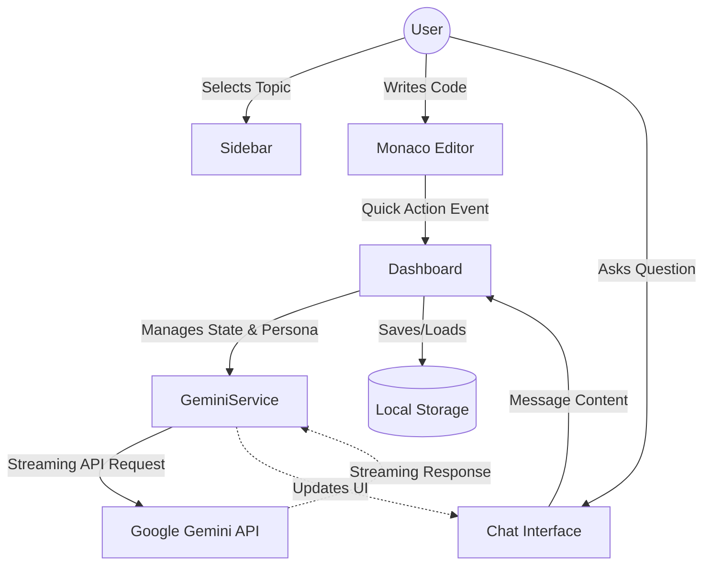

# DSA Mentor AI

A Socratic Data Structures and Algorithms (DSA) Instructor application powered by the Gemini API. This app acts as an encouraging, expert DSA mentor that guides students using the Socratic method—providing hints, edge-case checks, and Big-O time/space complexity analysis without giving away code immediately.

## 🚀 Features

- **Socratic AI Tutor Persona**: Guides users through conceptual understanding rather than just giving away code. Evaluates Time $O(N)$ and Space $O(1)$ complexity.
- **Dual Persona Mode**: 
  - *Mentor Mode*: Step-by-step hints and Socratic guidance.
  - *Code Review Mode*: Refactoring, Big-O analysis, and clean code practices.
- **Integrated Code Editor**: Side-by-side Monaco Editor with syntax highlighting for C++, Java, Python, and JavaScript. Includes quick actions for reviewing code, analyzing Big-O, generating edge cases, and asking for hints.
- **Structured Roadmap**: Topic-based roadmap (Arrays, Linked Lists, DP, etc.) with progress tracking.
- **Interactive Chat Interface**: Markdown rendering, code highlighting with one-click copy, and quick action prompt chips.
- **Persistent Storage**: Saves chat history, code, and progress locally.

## 🛠 Tech Stack

- **Frontend**: React (Vite), Tailwind CSS
- **Icons**: Lucide React
- **Editor**: `@monaco-editor/react`
- **Markdown & Highlighting**: `marked`, `highlight.js`
- **AI Integration**: `@google/generative-ai` (Gemini 2.5 Flash)

## 🏗 Architecture Flow Diagram



## ⚙️ Setup & Installation

1. **Clone the repository** (if applicable) or navigate to the project directory:
   ```bash
   cd chatbot
   ```

2. **Install dependencies**:
   ```bash
   npm install
   ```

3. **Start the development server**:
   ```bash
   npm run dev
   ```

4. **Add your API Key**:
   - Open the app in your browser (usually `http://localhost:5173`).
   - Open the Sidebar Settings.
   - Enter your Gemini API Key and start chatting!

## 📜 License
MIT License
